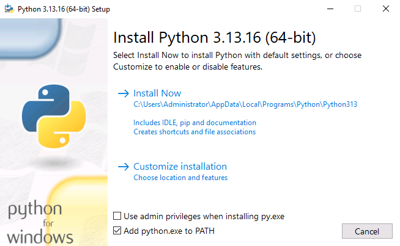
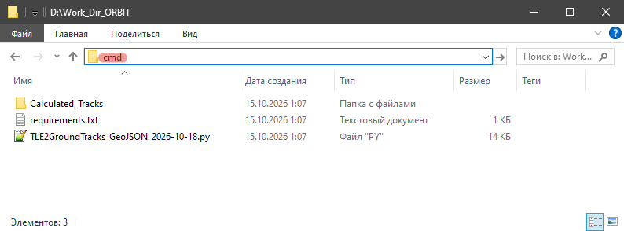
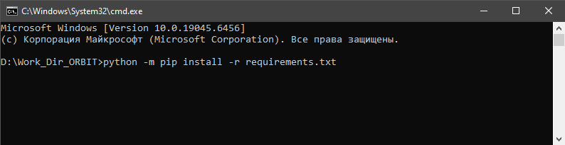
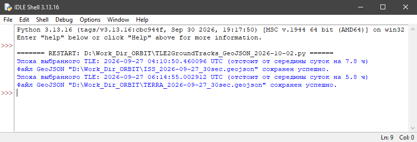
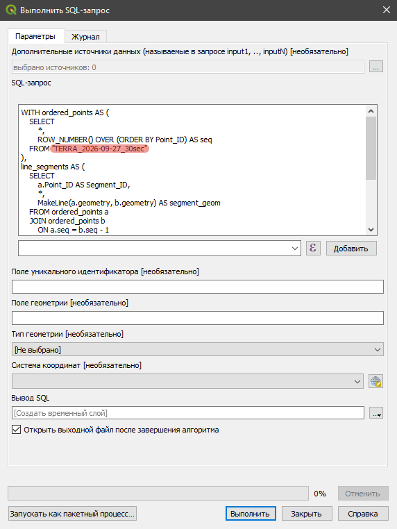
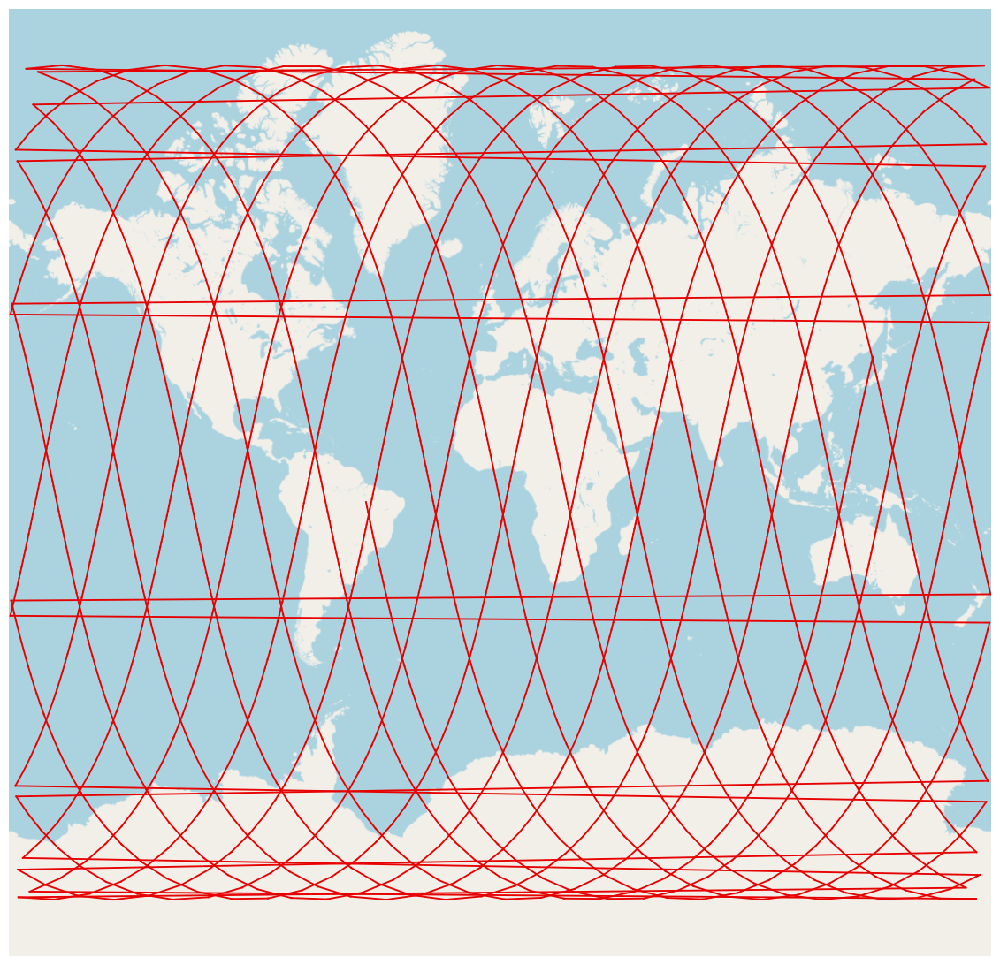
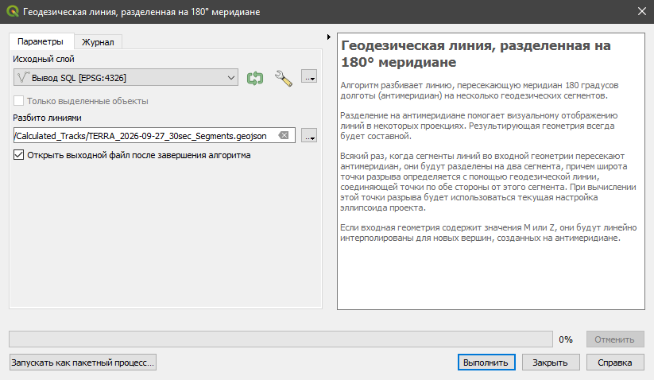
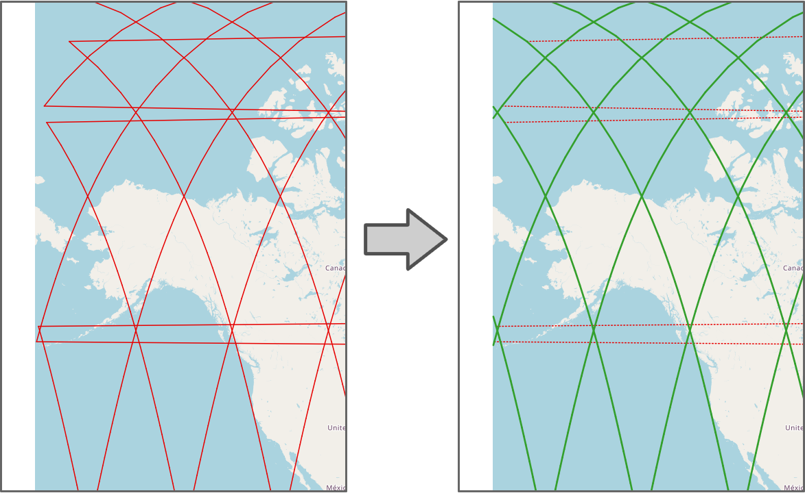
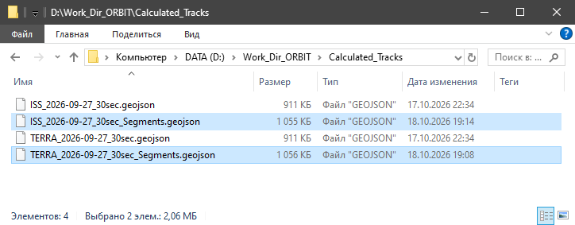

<!-- ВАЖНО: без "layout: default" локально не работает - сайт генерится, но без макета -->
<!-- А на GitHub, если есть любой пункт в заголовке, то сразу стр. 404. Нормально рендерится только когда вообще нет заголовка -->
<!-- Встречал еще какой-то tagline: Easy websites with GitHub Pages -->

<!-- 
    С проблемностью title/description при разворачивании на GitHub нашел пока такой выход:
    Если самая первая строка в README.md «простой текст», а не заголовок, то title/description берутся из _config.yml
 -->

Этот сайт можно открывать по короткой ссылке **<font color="#159957">bit.ly/RUDN-QGIS-ORBIT-L1</font>**. \
*Регистр букв должен быть сохранен, то есть заглавные буквы должны быть заглавными.*
<br><br>
<hr><hr> <!-- двойная разделительная линия ======================================================== -->
<br>


<!-- ISS Tracker Widget generator to your website! (https://isstracker.pl/en/info/cooperation) -->
<!-- Виджет isstracker.pl заменен собственным (см. ниже): сайт isstracker.pl без VPN из России не открывается.
<iframe width="600" height="300"
src="https://isstracker.pl/en/widget/map?
&disableInfoBox=1
&lang=en
&z=2
&mapType=satellite
&units=metric
&preloader=1
&showSatTooltip=1
&dayNightLayer=1
&showFutureOrbit=1"
style="max-width: 100%; border: 1px solid rgb(0, 163, 211); border-radius: 20px;">
</iframe>
 -->

<!-- Собственный виджет "МКС и TERRA сейчас": файлы в assets/iss-widget/ (MapLibre GL JS + satellite.js, TLE - в tle.json) -->
<link rel="stylesheet" href="{{ '/assets/iss-widget/vendor/maplibre-gl.css' | relative_url }}">
<link rel="stylesheet" href="{{ '/assets/iss-widget/iss-widget.css' | relative_url }}">
<div class="iss-widget"></div>
<script src="{{ '/assets/iss-widget/vendor/maplibre-gl.js' | relative_url }}"></script>
<script src="{{ '/assets/iss-widget/vendor/satellite.min.js' | relative_url }}"></script>
<script src="{{ '/assets/iss-widget/iss-widget.js' | relative_url }}"></script>

*Где сейчас находятся МКС и TERRA — два КА, трассы которых вы рассчитаете в этой работе. \
Их положение вычисляется прямо в вашем браузере по элементам TLE (CelesTrak) с помощью модели SGP4 — так же, как это делает Python&#8209;скрипт лабораторной работы. 
Сплошная линия показывает трассу КА на ближайшие полтора витка, затемнение — ночная сторона Земли.*


<!-- TOC -->

### ОГЛАВЛЕНИЕ

- [Введение](#введение)
- [Краткая теория](#краткая-теория)
	- [Зачем нужны наземные трассы КА](#зачем-нужны-наземные-трассы-ка)
	- [Двухстрочные элементы орбиты (TLE)](#двухстрочные-элементы-орбиты-tle)
	- [Почему трасса смещается к западу](#почему-трасса-смещается-к-западу)
- [Вариант задания](#вариант-задания)
- [Подготовка к работе](#подготовка-к-работе)
	- [Рабочая папка](#рабочая-папка)
	- [Установка Python и необходимых библиотек](#установка-python-и-необходимых-библиотек)
	- [Регистрация на Space-Track](#регистрация-на-space-track)
	- [Установка геоинформационной системы QGIS](#установка-геоинформационной-системы-qgis)
- [Расчет подспутниковых точек](#расчет-подспутниковых-точек)
	- [Ввод даты вашего варианта](#ввод-даты-вашего-варианта)
	- [Запуск скрипта на выполнение](#запуск-скрипта-на-выполнение)
	- [Результат расчета](#результат-расчета)
- [Создание линейных слоев трасс](#создание-линейных-слоев-трасс)
- [Анимация пролета КА в QGIS](#анимация-пролета-ка-в-qgis)
- [Типичные ошибки и их решение](#типичные-ошибки-и-их-решение)
- [Обязательный самоконтроль результатов](#обязательный-самоконтроль-результатов)
- [Контрольные вопросы](#контрольные-вопросы)
<br>

<!-- /TOC -->

<br>
## Введение

Данная лабораторная работа — первая из трех частей общей работы 
«**Расчет наземных трасс&nbsp;КА и работа с ними в геоинформационной системе QGIS**».

**Наземная (подспутниковая) трасса** космического аппарата (КА) — это линия на поверхности Земли, 
которую «прочерчивает» подспутниковая точка (точка, находящаяся прямо под КА) по мере его движения по орбите. 
Почему наземная трасса выглядит именно так, рассказано в разделе [«Краткая теория»](#краткая-теория).

В этой работе рассчитываются наземные трассы двух КА:

1\. <a href="https://ru.wikipedia.org/wiki/Международная_космическая_станция" 
      title="Ссылка на статью о МКС в Википедии" 
      target="_blank">
      <b>Международной космической станции</b></a>, сокр. МКС (англ. International Space Station, сокр. ISS) — пилотируемой орбитальной станции. \
Номер по спутниковому каталогу NORAD **25544**.

2\. <a href="https://ru.wikipedia.org/wiki/Терра_(спутник)" 
      title="Ссылка на статью о спутнике TERRA в Википедии" 
      target="_blank">
      <b>TERRA</b></a> — транснационального научно-исследовательского спутника, одного из основных спутников дистанционного зондирования Земли (ДЗЗ). \
Номер по спутниковому каталогу NORAD **25994**.

Орбиты этих КА существенно различаются, поэтому различаются и их наземные трассы:

<!-- Оформление таблицы - как в 3D-L1 (materials/variants_of_work.html): шапка #d5dce4, каждая вторая строка #f2f2f2.
     Внешняя обводка - как у скриншотов (#606c71). Сделана через outline, а не border: в теме Cayman у таблицы
     display: block и width: 100% (рамка была бы шире таблицы), а при border-collapse светлые рамки ячеек
     перекрывали бы рамку таблицы -->
<table style="display: table; outline: 1px solid #606c71; outline-offset: -1px;">
  <tr style="height: 4em;"> <!-- высота шапки - как у строк в две строки текста ("Тип орбиты") -->
    <th style="background-color: #d5dce4;">Параметр орбиты</th>
    <th style="background-color: #d5dce4; text-align: center;">МКС</th>
    <th style="background-color: #d5dce4; text-align: center;">TERRA</th>
  </tr>
  <tr><td>Дата запуска</td><td align="center">&nbsp;20&nbsp;ноября&nbsp;1998&nbsp;года&nbsp;<br><i>(первый модуль)</i></td><td align="center">&nbsp;18&nbsp;декабря&nbsp;1999&nbsp;года</td></tr>
  <tr style="background-color: #f2f2f2;"><td>Тип орбиты</td><td align="center">низкая&nbsp;околоземная</td><td align="center">солнечно&#8209;синхронная,<br>почти полярная</td></tr>
  <tr><td>Высота над поверхностью Земли</td><td align="center">≈&nbsp;420–435&nbsp;км</td><td align="center">≈&nbsp;690–710&nbsp;км</td></tr>
  <tr style="background-color: #f2f2f2;"><td>Наклонение</td><td align="center">51,6°</td><td align="center">97,9°</td></tr>
  <tr><td>Период обращения</td><td align="center">≈&nbsp;93,0&nbsp;мин</td><td align="center">≈&nbsp;98,5&nbsp;мин</td></tr>
  <tr style="background-color: #f2f2f2;"><td>Витков в сутки</td><td align="center">≈&nbsp;15,5</td><td align="center">≈&nbsp;14,6</td></tr>
  <tr><td>Скорость</td><td align="center">≈&nbsp;7,66&nbsp;км/с<br><i>(≈&nbsp;27&nbsp;600&nbsp;км/ч)</i></td><td align="center">≈&nbsp;7,51&nbsp;км/с<br><i>(≈&nbsp;27&nbsp;000&nbsp;км/ч)</i></td></tr>
</table>

*Значения — по данным TLE на октябрь 2026 года; параметры орбит со временем меняются.*
> <p style="margin-bottom: 4px;"><i>Высота КА над поверхностью Земли меняется и в пределах одного витка.<br>
> Диапазоны высот в таблице объясняются в основном <b>сплюснутостью Земли</b>, а&nbsp;не&nbsp;эллиптичностью орбит:</i></p>
> <p style="padding-left: 20px; text-indent: -21px; margin-top: 0; margin-bottom: 0;">&#9679;&nbsp; <i>сплюснутость Земли: поверхность у полюсов примерно на 21&nbsp;км ближе к центру Земли, чем на экваторе. 
> Поэтому над высокими широтами высота КА над поверхностью больше, даже если его расстояние до центра Земли почти не меняется: 
> у МКС (до 51,6° широты) — примерно на 13&nbsp;км, а у TERRA (почти до полюсов) — примерно на 20&nbsp;км;</i></p>
> <p style="padding-left: 20px; text-indent: -21px; margin-top: 0; margin-bottom: 8px;">&#9679;&nbsp; <i>эллиптичность орбит мала (эксцентриситет около 0,0007 у МКС и 0,0003 у TERRA) 
> и дает разброс высоты всего примерно ±5&nbsp;км у МКС и ±2&nbsp;км у TERRA.</i></p>

<br>
**В ходе работы вы:**

1. Рассчитаете с помощью Python&#8209;скрипта подспутниковые точки обоих КА на одни сутки вашего варианта 
   (раздел [«Расчет подспутниковых точек»](#расчет-подспутниковых-точек)).
2. Построите в QGIS линейные слои их трасс, состоящие из отдельных сегментов 
   (раздел [«Создание линейных слоев трасс»](#создание-линейных-слоев-трасс)).
3. Создадите в QGIS анимацию пролета КА 
   (раздел [«Анимация пролета КА в QGIS»](#анимация-пролета-ка-в-qgis)).

В результате у вас должны получиться **четыре ГИС&#8209;слоя** в формате GeoJSON (точечный и линейный для каждого КА) 
и **работающая анимация** пролета КА в QGIS:


*Пример результата: трассы МКС и TERRA на 27 сентября 2026 года в QGIS&#8209;проекте с анимацией пролета КА, 
настроенной в панели «Управление временем» (англ. Temporal Controller), на фоне карты OpenStreetMap.*

Созданные ГИС&#8209;слои понадобятся вам и в следующих частях работы, поэтому выполняйте все описанные здесь шаги **внимательно и аккуратно**.

> #### *Обратите внимание:*
> *Все время в этой работе — в данных, в расчетах и в итоговых слоях — это всемирное координированное время **UTC**, а не московское 
> (МСК = UTC&nbsp;+&nbsp;3&nbsp;ч). \
> Подробнее — в разделе [«Результат расчета»](#результат-расчета).*

<br>
🔼 [Вернуться к ОГЛАВЛЕНИЮ](#оглавление)

<br>
<hr><hr> <!-- двойная разделительная линия ======================================================== -->
<br>

## Краткая теория

### Зачем нужны наземные трассы КА

<!-- ЗАГОТОВКА: упрощенная цитата коллег из GIS-Lab (поиск данных ДЗЗ по времени пролета, например MODIS; планирование подспутниковых наблюдений) -->

### Двухстрочные элементы орбиты (TLE)

<!-- ЗАГОТОВКА: формат TLE с разбором полей, основные элементы орбиты; модель SGP4 и падение точности по мере удаления от эпохи TLE -->

### Почему трасса смещается к западу

<!-- ЗАГОТОВКА: вращение Земли и смещение витков к западу; ссылка https://en.wikipedia.org/wiki/Satellite_ground_track (на английском) -->

<br>
🔼 [Вернуться к ОГЛАВЛЕНИЮ](#оглавление)

<br>
<hr><hr> <!-- двойная разделительная линия ======================================================== -->
<br>

## Вариант задания

У каждого студента в этой работе свой вариант.

Варианты отличаются датой, для которой будет рассчитываться орбита КА.

Дату брать следующим образом: [день *– ваш номер по списку группы*] **сентября 2026**.

<!-- ЗАГОТОВКА: пример - студент с номером 27 рассчитывает орбиты на 27 сентября 2026 года (эта дата используется во всех примерах инструкции) -->

<br>
🔼 [Вернуться к ОГЛАВЛЕНИЮ](#оглавление)

<br>
<hr><hr> <!-- двойная разделительная линия ======================================================== -->
<br>

## Подготовка к работе

### Рабочая папка

При работе на своем личном компьютере (ноутбуке) создайте в корне диска «C:» (или диска «D:», если имеется) отдельную рабочую папку с названием, например, «**Work_Dir_ORBIT**». \
Если же вы используете учебный компьютер, установленный в аудитории, и&nbsp;входите в систему под своей личной учетной записью, создайте такую папку на рабочем столе 
— это защитит ваши файлы от возможного удаления или изменения другими студентами, поскольку у&nbsp;них не будет доступа к&nbsp;вашей рабочей папке. \
В любом случае все скачиваемые и создаваемые вами в этой работе файлы помещайте **только в эту папку**. \
Не "разбрасывайте" файлы и папки с данными по всему компьютеру!

Внутри рабочей папки сразу создайте еще одну папку — «**Calculated_Tracks**». В ней будут храниться все рассчитанные вами ГИС&#8209;слои трасс.

> #### *Внимание !!!*
> *Имена всех ваших файлов и папок (как и пути к ним) не должны содержать русских букв и специальных символов (кроме допускающегося нижнего подчеркивания «_»&nbsp;).*
> *Нигде не должно быть <u>пробелов</u>, точек, запятых и т.п.*
> *Везде должны быть только английские буквы и/или цифры.* \
> *Так вам будет проще набирать пути в командной строке, а программы не "споткнутся" о&nbsp;непривычные для них символы.*

<br>
### Установка Python и необходимых библиотек

Расчет трасс выполняется программой (скриптом) на языке **Python**. \
Для ее работы на вашем компьютере должен быть установлен Python версии **не ниже 3.10**. \
Рекомендуемые версии — **Python&nbsp;3.12** или **Python&nbsp;3.13**.

> #### *Почему именно эти версии:*
> *Python 3.10 в октябре 2026 года завершает свой жизненный цикл (перестает поддерживаться разработчиками), поэтому ориентироваться на него не стоит. \
> Самые свежие версии (3.14 и новее) тоже лучше не брать — для них иногда запаздывают готовые сборки необходимых библиотек.*

**Проверьте, установлен ли Python на вашем компьютере.** \
Откройте командную строку: для этого нажмите на клавиатуре комбинацию клавиш «**Win&nbsp;+&nbsp;R**», введите `cmd` и нажмите «**Enter**». \
В открывшемся черном окне командной строки введите следующую команду и нажмите «**Enter**»:

```
python --version
```

Если в ответ появится строка вида `Python 3.13.x` или `Python 3.12.x` (где `x` — номер выпуска), то Python у вас уже установлен — переходите сразу к скачиванию файлов работы (см. ниже). \
Если же появится сообщение об ошибке *(или вместо ответа откроется магазин приложений Microsoft&nbsp;Store)*, установите Python.

**Установка Python в ОС Windows:**

- Перейдите на страницу загрузок для Windows официального сайта проекта Python по 
   <a href="https://www.python.org/downloads/windows/" 
      title="Ссылка на страницу загрузок Python для Windows" 
      target="_blank">
      <b>ссылке</b></a>.
- Найдите в списке последний выпуск **Python&nbsp;3.13** и скачайте для него установщик «**Windows&nbsp;installer&nbsp;(64&#8209;bit)**».
- Запустите скачанный установщик. \
  В первом окне мастера установки **обязательно поставьте галочку** «**Add&nbsp;python.exe&nbsp;to&nbsp;PATH**» (она находится внизу окна и по умолчанию снята):



> *Без этой галочки команда `python` в командной строке работать не будет (Windows просто "не найдет" программу). \
> Если у вас нет прав администратора компьютера (например, на учебном компьютере), снимите галочку «Use&nbsp;admin&nbsp;privileges&nbsp;when&nbsp;installing&nbsp;py.exe».*

- Нажмите «**Install&nbsp;Now**» и дождитесь окончания установки.
- **Закройте** окно командной строки, откройте его заново и еще раз выполните <span style="white-space: nowrap">команду <code>python --version</code></span> — теперь она должна показать установленную версию.

> *Для ОС **macOS** установщик Python также можно скачать с сайта 
   <a href="https://www.python.org/downloads/macos/" 
      title="Ссылка на страницу загрузок Python для macOS" 
      target="_blank">
      <b>python.org</b></a>. 
> Обратите внимание, что в macOS во всех приведенных ниже командах <span style="white-space: nowrap">вместо <code>python</code> нужно писать <code>python3</code></span>.*

<br>
**Скачайте необходимые для работы файлы** и сохраните их в вашей рабочей папке:

- программу (скрипт) для расчета трасс — 
   <a href="./materials/TLE2GroundTracks_GeoJSON.py" 
      download="TLE2GroundTracks_GeoJSON.py" 
      title="Ссылка для загрузки Python-скрипта">
      <b>TLE2GroundTracks_GeoJSON.py</b></a>;
- список необходимых скрипту библиотек — 
   <a href="./materials/requirements.txt" 
      download="requirements.txt" 
      title="Ссылка для загрузки файла requirements.txt">
      <b>requirements.txt</b></a>.

> *Скачивайте файлы именно по этим ссылкам, а не копируйте текст программы из окна браузера — при копировании могут нарушиться отступы, а для Python они имеют принципиальное значение.*

<br>
**Установите дополнительные библиотеки, необходимые для работы скрипта:**

- **spacetrack** — для получения параметров орбит с сайта Space&#8209;Track;
- **pyorbital** — для расчета положения КА на орбите.

Откройте командную строку **сразу в вашей рабочей папке**. 
Для этого откройте рабочую папку в&nbsp;Проводнике Windows, щелкните левой клавишей мыши по адресной строке Проводника (вверху&nbsp;окна), 
сотрите в ней путь, введите `cmd` и нажмите «**Enter**»:



В открывшейся командной строке введите команду:

```
python -m pip install -r requirements.txt
```



Выполните ее, нажав «**Enter**».

Программа установки **pip** скачает и установит библиотеки spacetrack и pyorbital, а также все библиотеки, которые нужны уже им самим. 
Первая установка занимает **несколько минут** — не прерывайте ее, даже если кажется, что ничего не происходит. \
Об успешной установке сообщит строка, начинающаяся со слов `Successfully installed`.

> #### *Если установка завершилась ошибкой доступа:*
> *На учебных компьютерах без прав администратора pip может сообщить об отсутствии прав на запись (`Permission denied`, `Access is denied`). 
> В этом случае выполните ту же команду, добавив в конце ключ `--user` (установка только для вашей учетной записи):*
> 
> ```
> python -m pip install -r requirements.txt --user
> ```

**Проверьте установку**, выполнив команду:

```
python -c "import spacetrack, pyorbital; print('OK')"
```

Если в ответ напечаталось `OK`, то все необходимое установлено правильно.

<br>
### Регистрация на Space-Track

Параметры орбит КА (так называемые TLE) скрипт получает с сайта 
   <a href="https://www.space-track.org" 
      title="Ссылка на сайт Space-Track" 
      target="_blank">
      <b>Space&#8209;Track</b></a> 
— официального ресурса, который ведет каталог искусственных объектов на околоземной орбите и хранит архив их орбитальных параметров. 
Доступ к данным бесплатный, но требует регистрации.

> *Существует и другой популярный бесплатный источник TLE — сайт 
   <a href="https://celestrak.org" 
      title="Ссылка на сайт CelesTrak" 
      target="_blank">
      CelesTrak</a> (регистрация не нужна). 
> Однако он предоставляет только актуальные (самые свежие) TLE, а для расчета трасс на прошедшие даты необходимы архивные данные, которые есть именно на Space&#8209;Track.*

Зарегистрируйтесь на сайте Space&#8209;Track, нажав на его главной странице «**Create&nbsp;Account**» и заполнив регистрационную форму. \
На указанную вами электронную почту (email) придет письмо со ссылкой — перейдите по ней, создайте пароль для вашей учетной записи и завершите процесс регистрации. \
**Регистрируйтесь заблаговременно** — подтверждение регистрации может прийти не сразу.

После получения доступа впишите ваши логин и пароль от Space&#8209;Track в скрипт. \
Для этого найдите на компьютере через меню «Пуск» программу-редактор **IDLE** 
*(ярлык называется «IDLE&nbsp;(Python&nbsp;3.13&nbsp;64&#8209;bit)» и&nbsp;устанавливается вместе с Python&nbsp;3.13; 
чтобы быстро его найти, просто начните набирать в&nbsp;меню «Пуск» слово `IDLE`)*, 
запустите ее и откройте в ней файл скрипта через меню «**File&nbsp;&rArr;&nbsp;Open...**». 
В&nbsp;начале скрипта найдите строки:

```python
# Имя пользователя и пароль (регистрация на https://www.space-track.org)
USERNAME = 'ваш_логин'
PASSWORD = 'ваш_пароль'
```

и замените текст `ваш_логин` и `ваш_пароль` на ваши учетные данные. **Одинарные кавычки** вокруг них должны остаться. \
Сохраните изменения, нажав на клавиатуре комбинацию клавиш «**Ctrl&nbsp;+&nbsp;S**».

> #### ⚠️ *Очень важно:*
> *Скрипт с вписанными в него логином и паролем — это **ваш личный** файл. Никому его не пересылайте, не выкладывайте в интернет и не&nbsp;отправляйте преподавателю. 
> Если&nbsp;скрипт нужно кому-то показать, сначала удалите из него пароль.* \
> \
> *Space&#8209;Track ограничивает частоту запросов к своим данным. 
> Если много раз подряд запускать скрипт (особенно, когда это одновременно делает вся группа), ваш аккаунт может быть **временно заблокирован**. 
> Поэтому запускайте скрипт только после того, как внимательно проверили все внесенные в него изменения, и не запускайте его повторно без необходимости.*

<br>
### Установка геоинформационной системы QGIS

Для выполнения данной работы вам потребуется геоинформационная система 
   <a href="https://qgis.org" 
      title="Ссылка на сайт проекта QGIS" 
      target="_blank">
      <b>QGIS</b></a>.
Это свободно распространяемое программное обеспечение, для его установки и использования не требуется покупка или регистрация. \
*Если QGIS версии 3.16.16 у вас уже установлена, этот шаг пропустите.*

> Скачать установщик QGIS версии **3.16.16** для ОС **Windows** можно по прямой 
   <a href="https://download.osgeo.org/qgis/win64/QGIS-OSGeo4W-3.16.16-1-Setup-x86_64.exe" 
      title="Ссылка для загрузки установщика QGIS для Windows">
      <b>ссылке</b></a>. \
> *Именно эта версия программы рекомендуется для выполнения данной работы, так как обладает высокой производительностью (быстродействием), 
небольшим объемом дистрибутива и занимаемого места на диске, а также отличной стабильностью, минимизирующей сбои во время работы.* \
> *Резервный вариант загрузки этого установщика доступен по 
   <a href="https://disk.yandex.ru/d/VWfWW6D0sN7Xug" 
      title="Резервная ссылка для загрузки установщика QGIS для Windows"
      target="_blank">
      <b>ссылке</b></a>.*
> 
> Установщик ГИС QGIS для ОС **macOS** можно скачать с сайта проекта QGIS по 
   <a href="https://qgis.org/ru/site/forusers/download.html" 
      title="Ссылка для загрузки установщика QGIS для macOS"
      target="_blank">
      <b>ссылке</b></a>. \
> Скачивайте и устанавливайте стабильную версию (Long Term Release, LTR) программы. \
> *Обязательно обратите внимание на Советы по первому запуску (Tips for first launch), относящиеся к системе безопасности Apple.*

<br>
⚠️ При установке QGIS не изменяйте предлагаемые мастером установки параметры. В том числе: \
&nbsp;&nbsp;&nbsp;&nbsp;&nbsp;&nbsp;&nbsp;&nbsp;&nbsp; ✔&nbsp; папку для установки программы QGIS оставьте предлагаемой по умолчанию, \
&nbsp;&nbsp;&nbsp;&nbsp;&nbsp;&nbsp;&nbsp;&nbsp;&nbsp; ✘&nbsp; не устанавливайте предлагаемые наборы данных (в них нет необходимости).

Запустите геоинформационную систему QGIS, чтобы убедиться в ее работоспособности. \
Для этого в ОС Windows нажмите кнопку «**Пуск**», перейдите к группе «**QGIS&nbsp;3.16**» и выберите программу «**QGIS&nbsp;Desktop&nbsp;3.16.16&nbsp;with&nbsp;GRASS&nbsp;7.8.5**».

<br>
🔼 [Вернуться к ОГЛАВЛЕНИЮ](#оглавление)

<br>
<hr><hr> <!-- двойная разделительная линия ======================================================== -->
<br>

## Расчет подспутниковых точек

Подспутниковые точки (положения КА, спроецированные на поверхность Земли) мы рассчитаем с&nbsp;помощью скачанного ранее Python&#8209;скрипта.

### Ввод даты вашего варианта

Откройте скрипт в редакторе IDLE и перейдите в самый его конец. 
Там находятся две строки, запускающие расчет — для МКС и для спутника TERRA:

```python
# ISS (ZARYA) ( NORAD ID 25544 )
create_orbital_track_geojson_for_day(25544, date(2026, 9, 32), 0.5, r'ISS_2026-09-32_30sec.geojson')

# TERRA ( NORAD ID 25994 )
create_orbital_track_geojson_for_day(25994, date(2026, 9, 32), 0.5, r'TERRA_2026-09-32_30sec.geojson')
```

Значения в каждой строке означают:
- `25544` (или `25994`) — номер КА по спутниковому каталогу NORAD;
- `date(2026, 9, 32)` — дата расчета: год, месяц, день;
- `0.5` — шаг расчета в минутах *(0,5&nbsp;мин = 30&nbsp;секунд — отсюда «_30sec» в имени файла)*;
- `ISS_2026-09-32_30sec.geojson` — имя создаваемого файла с результатом *(в коде оно записано в&nbsp;одинарных кавычках с буквой `r` впереди — их при редактировании не удаляйте)*.

Дня «32» в сентябре, как и в любом другом месяце, конечно, не бывает — это сделано специально: дату своего варианта вы должны вписать сами. \
**Измените в четырех местах** число «32» на день вашего варианта — в каждой из двух строк дважды: в дате `date(...)` и&nbsp;в&nbsp;имени создаваемого файла.

Например, для варианта на 27 сентября 2026 года строки должны принять вид:

```python
# ISS (ZARYA) ( NORAD ID 25544 )
create_orbital_track_geojson_for_day(25544, date(2026, 9, 27), 0.5, r'ISS_2026-09-27_30sec.geojson')

# TERRA ( NORAD ID 25994 )
create_orbital_track_geojson_for_day(25994, date(2026, 9, 27), 0.5, r'TERRA_2026-09-27_30sec.geojson')
```

> #### ⚠️ *Обратите внимание:*
> *Если не исправить день, то при запуске скрипт завершится ошибкой* `ValueError: day is out of range for month` *(«день вне допустимого диапазона для месяца»).* \
> \
> *Если ваш день меньше 10, то в дате `date(...)` его нужно писать **одной цифрой, без нуля впереди**:* \
> &nbsp;&nbsp;&nbsp;&nbsp;✔&nbsp; правильно: `date(2026, 9, 6)` \
> &nbsp;&nbsp;&nbsp;&nbsp;✘&nbsp; ошибка: `date(2026, 09, 06)` *— Python вообще откажется запускать такой скрипт с&nbsp;ошибкой* `SyntaxError`. \
> *А вот в имени файла ноль впереди, наоборот, нужен (для единообразия имен создаваемых файлов):* `ISS_2026-09-06_30sec.geojson`.

Шаг расчета `0.5` в этой работе **не изменяйте**.

Сохраните внесенные в скрипт изменения, нажав на клавиатуре комбинацию клавиш «**Ctrl&nbsp;+&nbsp;S**».

<br>
### Запуск скрипта на выполнение

Запустить скрипт можно одним из двух способов.

**Способ 1 — из командной строки.** \
Откройте командную строку в вашей рабочей папке (через адресную строку Проводника, как это описано выше в разделе об установке дополнительных библиотек) и выполните команду:

```
python TLE2GroundTracks_GeoJSON.py
```

> *Чтобы не набирать длинное имя файла целиком, введите `python TLE` и нажмите клавишу «**Tab**» — имя файла допишется автоматически.*

**Способ 2 — из редактора IDLE.** \
В окне IDLE с открытым скриптом выберите в меню «**Run&nbsp;&rArr;&nbsp;Run&nbsp;Module**» или просто нажмите клавишу «**F5**». 
Сообщения скрипта появятся в отдельном окне «IDLE Shell».

Расчет обычно занимает от нескольких секунд до минуты (большая часть времени уходит на связь с сервером Space&#8209;Track).

<br>
### Результат расчета

При успешном выполнении скрипт для каждого КА выведет два сообщения, а в рабочей папке *(там&nbsp;же, где находится сам скрипт)* появятся два новых файла 
— **ISS_2026-09-27_30sec.geojson** и **TERRA_2026-09-27_30sec.geojson** *(с датой вашего варианта)*:



Первое сообщение показывает **эпоху** использованного набора TLE — момент времени, на который рассчитаны параметры орбиты. 
Скрипт выбирает из архива Space&#8209;Track набор TLE с эпохой, ближайшей к середине (12:00 UTC) суток вашего варианта, 
и сообщает, на сколько именно часов она от нее отстоит. \
Если появится предупреждение `ВНИМАНИЕ: за ближайшие к указанной дате сутки TLE не публиковались...` — это не ошибка: расчет выполнен, 
но по более старым (или более новым) параметрам орбиты, и точность рассчитанной трассы может быть несколько ниже. *Почему так происходит, объясняется в разделе [«Краткая теория»](#краткая-теория).*

Второе сообщение подтверждает, что файл с результатом расчета успешно сохранен, и показывает полный путь к нему.

<br>
Созданные файлы имеют формат 
   <a href="https://ru.wikipedia.org/wiki/GeoJSON" 
      title="Ссылка на статью о GeoJSON в Википедии" 
      target="_blank">
      <b>GeoJSON</b></a> 
— открытый текстовый формат для хранения географических данных, который понимают практически все ГИС и веб&#8209;карты. \
Каждый файл содержит **точечный ГИС&#8209;слой**: при шаге 30&nbsp;секунд за сутки получается 2880 точек. 
Для&nbsp;каждой точки рассчитаны следующие атрибуты:

| Атрибут | Описание |
|---|---|
| `Point_ID` | порядковый номер подспутниковой точки (начиная с `0`) |
| `Orbit_Num` | номер витка КА |
| `Date_Time` | дата и время в формате `ГГГГ-ММ-ДД ЧЧ:ММ:СС` (**UTC**) |
| `Latitude` | широта подспутниковой точки, градусы |
| `Longitude` | долгота подспутниковой точки, градусы |
| `Altitude` | высота КА над поверхностью Земли, км |
| `Velocity` | скорость КА, км/с |
| `Sun_Zenith` | зенитный угол Солнца в подспутниковой точке, градусы |
| `Orbit_Incl` | наклонение орбиты КА, градусы |

> #### *Обратите внимание на важный момент:*
> *Время в атрибуте `Date_Time` (как и во всей работе) — это всемирное координированное время **UTC** (англ. Coordinated Universal Time), а не московское время. 
> Московское время опережает UTC на 3&nbsp;часа: например, 12:00&nbsp;UTC — это 15:00 по Москве.*

> #### *Что такое зенитный угол Солнца:*
> <p style="margin-bottom: 8px;"><i>Зенитный угол Солнца — это угол между направлением на Солнце и направлением в зенит (то есть вертикально вверх). 
> В наших данных он рассчитан для подспутниковой точки — точки на поверхности Земли, над которой в данный момент находится КА.</i></p>
> <p style="margin-top: 0; margin-bottom: 4px;"><i>Угол может принимать значения от 0° до 180°:</i></p>
> <p style="padding-left: 20px; text-indent: -21px; margin-top: 0; margin-bottom: 0;">&#9679;&nbsp; <i>0° — Солнце в зените, прямо над точкой;</i></p>
> <p style="padding-left: 20px; text-indent: -21px; margin-top: 0; margin-bottom: 0;">&#9679;&nbsp; <i>90° — Солнце на горизонте;</i></p>
> <p style="padding-left: 20px; text-indent: -21px; margin-top: 0; margin-bottom: 8px;">&#9679;&nbsp; <i>больше 90° — Солнце под горизонтом: в подспутниковой точке сумерки или ночь, то&nbsp;есть КА находится над ночной стороной Земли.</i></p>
> <p style="margin-top: 0; margin-bottom: 8px;"><i>Высоту Солнца над горизонтом легко получить как «90°&nbsp;−&nbsp;зенитный угол». Например, при зенитном угле 60° Солнце стоит на 30° над горизонтом. 
> Отрицательная высота означает, что Солнце находится под горизонтом.</i></p>
> <p style="margin-top: 0; margin-bottom: 4px;"><i>Для дистанционного зондирования Земли (ДЗЗ) этот параметр очень важен: он&nbsp;показывает, как освещен участок поверхности, который «видит» съемочная аппаратура КА. 
> От него зависят:</i></p>
> <p style="padding-left: 20px; text-indent: -21px; margin-top: 0; margin-bottom: 0;">&#9679;&nbsp; <i>освещенность снимаемой (зондируемой) местности — чем ниже Солнце, тем она слабее и тем длиннее тени;</i></p>
> <p style="padding-left: 20px; text-indent: -21px; margin-top: 0; margin-bottom: 0;">&#9679;&nbsp; <i>планирование съемки — оптическая съемка возможна только на освещенной стороне Земли, причем лишь при достаточно высоком положении Солнца, а для некоторых специфических задач (например, анализа теней для оценки высоты объектов) нужен определенный угол Солнца;</i></p>
> <p style="padding-left: 20px; text-indent: -21px; margin-top: 0; margin-bottom: 0;">&#9679;&nbsp; <i>сопоставимость снимков — чтобы сравнивать отражательную способность (альбедо) поверхности в разных местах и в разное время, яркость пересчитывают с&nbsp;учетом зенитного угла;</i></p>
> <p style="padding-left: 20px; text-indent: -21px; margin-top: 0; margin-bottom: 8px;">&#9679;&nbsp; <i>атмосферная коррекция — чем больше угол, тем длиннее путь солнечного луча в атмосфере и тем сильнее рассеяние и поглощение проходящего через нее света.</i></p>
> <p style="margin-top: 0;"><i>Поэтому спутники ДЗЗ, такие как TERRA, часто выводят на солнечно&#8209;синхронную орбиту: такой КА пересекает экватор всегда в одно и то же местное время, 
> и условия освещения от снимка к снимку остаются почти одинаковыми.</i></p>

<br>
Обязательно перенесите оба созданных файла в папку «**Calculated_Tracks**», уже имеющуюся внутри вашей рабочей папки.

<br>
🔼 [Вернуться к ОГЛАВЛЕНИЮ](#оглавление)

<br>
<hr><hr> <!-- двойная разделительная линия ======================================================== -->
<br>

## Создание линейных слоев трасс

Создайте новый (пустой) QGIS-проект.

Добавьте в него **первым слоем** базовую карту «OpenStreetMap» (OSM&nbsp;Standard). \
В QGIS 3.16.16 это можно сделать через панель «**Обозреватель**»: раскройте в ней группу «**XYZ&nbsp;Tiles**» 
и дважды щелкните левой клавишей мыши по «**OpenStreetMap**» *(или перетащите его мышью на окно Карты)*.

> *Базовую карту OpenStreetMap следует добавлять именно первым слоем: QGIS&#8209;проект при этом автоматически получит систему координат этой карты 
> — Веб&#8209;Меркатор (EPSG:3857), в которой мы и будем работать далее (в том числе при создании анимации пролета КА).*

Затем добавьте в проект созданные слои подспутниковых точек в формате GeoJSON, перетащив их файлы мышью из папки «Calculated_Tracks» на окно Карты.

Откройте в интерфейсе QGIS панель «**Инструменты анализа**» через меню «Вид &rArr; Панели &rArr; Инструменты&nbsp;анализа» или нажав кнопку .

Найдите в группе «**Вектор - общие инструменты**» (<u>именно в ней</u>) алгоритм «**Выполнить SQL&#8209;запрос**» (англ. Execute SQL) и откройте его панель (диалоговое окно).

Скопируйте представленный ниже код (SQL&#8209;запрос) и вставьте его на панели алгоритма в&nbsp;ячейку&nbsp;«SQL&#8209;запрос».

```sql
WITH ordered_points AS (
    SELECT
        *,
        ROW_NUMBER() OVER (ORDER BY Point_ID) AS seq
    FROM "<Имя слоя подспутниковых точек>"
),
line_segments AS (
    SELECT
        a.Point_ID AS Segment_ID,
        *,
        MakeLine(a.geometry, b.geometry) AS segment_geom
    FROM ordered_points a
    JOIN ordered_points b
        ON a.seq = b.seq - 1
)
SELECT
    Collect(segment_geom) AS geometry,
    (Segment_ID + 1) AS Segment_ID,
    Orbit_Num, Date_Time, Latitude, Longitude,
    Altitude, Velocity, Sun_Zenith, Orbit_Incl
FROM line_segments
GROUP BY Segment_ID
```

Измените текст `<Имя слоя подспутниковых точек>`, включая входящие в него угловые скобки **<** и **>**, на&nbsp;имя соответствующего слоя 
*(в моем примере ниже это «TERRA_2026-09-27_30sec»)*.

Ячейку «Вывод SQL» оставьте незаполненной — таким образом создастся и добавится в QGIS временный слой.



Запустите алгоритм «Выполнить SQL&#8209;запрос», нажав кнопку «**Выполнить**».

Полученный новый линейный слой с именем «**Вывод&nbsp;SQL**» будет состоять из отдельных сегментов (коротких отрезков) трассы, 
а каждому сегменту присвоятся соответствующие точке его начала атрибутивные данные.

*Поле `Date_Time` в этом временном слое — текстовое (тип `QString`); в итоговом GeoJSON&#8209;файле оно снова станет полем «дата и время» (тип `QDateTime`).*

Однако у полученного слоя будут характерные артефакты: «горизонтальные линии» через всю карту, а у краев карты (на&nbsp;±180°) трассы будут обрываться, не доходя до них. \
Эти артефакты возникают там, где КА пересекает меридиан 180° долготы (антимеридиан). 
Например, одна точка трассы имеет долготу +178,6°, а следующая (через 30&nbsp;секунд) — уже −179,7°. 
На самом деле КА пролетел между ними всего около 2°, но ГИС соединяет эти точки отрезком «по карте», а не «по глобусу» 
— и проводит линию через всю карту, почти на 360° в обратную сторону:



Устранить данное явление можно с помощью алгоритма «**Геодезическая линия, разделенная на 180°&nbsp;меридиане**» (англ. Geodesic line split at antimeridian), 
применив его к временному линейному слою «Вывод&nbsp;SQL».

Воспользовавшись поиском, имеющимся в панели «Инструменты&nbsp;анализа», найдите алгоритм «Геодезическая линия, разделенная на 180°&nbsp;меридиане» 
*(он находится в группе «Инструменты обработки геометрии векторных объектов»)* и откройте его диалоговое окно.

Укажите путь к папке «Calculated_Tracks» для сохранения файла. Выберите формат **GeoJSON** *(именно обычный* `*.geojson`*)* 
и назовите файл по имени слоя соответствующей орбиты, добавив в&nbsp;конце «**_Segments**» 
*(в моем примере это «TERRA_2026-09-27_30sec_Segments.geojson»)*.


<br><br>
> #### *Как работает этот алгоритм:*
> *Алгоритм находит все отрезки трассы, пересекающие антимеридиан, и разрезает каждый из них на две части точно по меридиану 180°. 
> Место разреза он вычисляет по **геодезической** линии — кратчайшему пути между концами отрезка по поверхности Земли, — то есть там, где КА на самом деле пересек антимеридиан. \
> Одна часть разрезанного отрезка заканчивается на +180°, другая начинается на −180°. При этом обе части остаются **одним** объектом слоя, поэтому число сегментов и их атрибуты не меняются. 
> В результате «горизонтальных линий» больше нет, а трассы доходят точно до краев карты:* \
> <br>
> &nbsp;&nbsp;&nbsp;&nbsp;&nbsp;&nbsp; 
> <br><br>
> *Поэтому такие слои наземных трасс отлично подходят для карт в общемировых системах координат и проекциях с центральным меридианом 0° (Гринвич), таких как:*
> 
> <p style="padding-left: 20px; text-indent: -21px; margin-bottom: -10px; font-size: 0.95em;">&#9679;&nbsp; <i>Веб&#8209;Меркатор, или «Псевдо&#8209;Меркатор» (WGS&nbsp;84 / Pseudo&#8209;Mercator, EPSG:3857);</i></p>
> <p style="padding-left: 20px; text-indent: -21px; margin-bottom: -10px; font-size: 0.95em;">&#9679;&nbsp; <i>географическая система координат WGS&nbsp;84 — широта и долгота в градусах (EPSG:4326);</i></p>
> <p style="padding-left: 20px; text-indent: -21px; margin-bottom: -10px; font-size: 0.95em;">&#9679;&nbsp; <i>проекции Эккерта III и IV (Sphere_Eckert_III — ESRI:53013, Sphere_Eckert_IV — ESRI:53012);</i></p>
> <p style="padding-left: 20px; text-indent: -21px; margin-bottom: -10px; font-size: 0.95em;">&#9679;&nbsp; <i>проекция Айтова (Sphere_Aitoff — ESRI:53043, World_Aitoff — ESRI:54043);</i></p>
> <p style="padding-left: 20px; text-indent: -21px; margin-bottom: 10px; font-size: 0.95em;">&#9679;&nbsp; <i>равновеликая проекция Equal Earth (WGS&nbsp;84 / Equal Earth Greenwich, EPSG:8857).</i></p>
> 
> *В проекциях с другим центральным меридианом линия разреза окажется уже не на краю карты — с такими случаями мы разберемся в следующей части работы.*

<br>
Запустите алгоритм «Геодезическая линия, разделенная на 180°&nbsp;меридиане», нажав «**Выполнить**».

Удалите из QGIS-проекта промежуточный временный слой «Вывод&nbsp;SQL».

Повторите последовательно алгоритмы «Выполнить SQL&#8209;запрос» и «Геодезическая линия, разделенная на 180°&nbsp;меридиане» для **второго** КА (**МКС**).

В результате в папке «Calculated_Tracks» у вас должно получиться (создаться) четыре файла *(в&nbsp;моем примере орбиты рассчитаны для 27 сентября 2026 года)*:


<br><br>
> #### *Справочно:*
> *Линию трассы из слоя подспутниковых точек можно построить и проще — с помощью алгоритма «**Точки в контур**» (англ. Points to path) из группы «Инструменты создания векторных объектов». 
> Он соединяет точки слоя в определенном порядке (например, по&nbsp;полю `Point_ID`) в одну сплошную линию, а если при этом задать поле группировки (например, `Orbit_Num`) — в отдельную линию для каждого витка. \
> Однако у такой линии не будет разделения на отдельные сегменты трассы (соединяющие соседние подспутниковые точки) с соответствующими им атрибутами: временем, высотой, зенитным углом Солнца и другими параметрами. 
> А именно такие линии понадобятся в следующих частях работы для стилизации и анализа трасс. 
> Поэтому в данной работе линии подспутниковых трасс строятся из отдельных сегментов (представляющих собой самостоятельные объекты линейного слоя) с&nbsp;помощью SQL&#8209;запроса.*

<br>
🔼 [Вернуться к ОГЛАВЛЕНИЮ](#оглавление)

<br>
<hr><hr> <!-- двойная разделительная линия ======================================================== -->
<br>

## Анимация пролета КА в QGIS

<!-- ЗАГОТОВКА: проект в EPSG:3857, фон OpenStreetMap; свойства точечного слоя - вкладка "Хронология" (поле Date_Time); панель управления временем; время UTC; стили - по желанию -->


<br>
🔼 [Вернуться к ОГЛАВЛЕНИЮ](#оглавление)

<br>
<hr><hr> <!-- двойная разделительная линия ======================================================== -->
<br>

## Типичные ошибки и их решение

<!-- ЗАГОТОВКА: ValueError (день 32); SyntaxError (ведущий ноль); "python не является внутренней или внешней командой" (PATH); ошибка доступа pip (--user); неверный логин Space-Track; "Невозможно извлечь TLE"; файл не найден / сохранен не там; горизонтальные линии через всю карту -->

<br>
🔼 [Вернуться к ОГЛАВЛЕНИЮ](#оглавление)

<br>
<hr><hr> <!-- двойная разделительная линия ======================================================== -->
<br>

## Обязательный самоконтроль результатов

<!-- ЗАГОТОВКА: проверка 4 файлов, их таблиц атрибутов и типа поля Date_Time; работающая анимация; от результатов зависит выполнение Частей 2 и 3; результат должен быть предоставлен (продемонстрирован) преподавателю по первому требованию -->

<br>
🔼 [Вернуться к ОГЛАВЛЕНИЮ](#оглавление)

<br>
<hr><hr> <!-- двойная разделительная линия ======================================================== -->
<br>

## Контрольные вопросы

<!-- ЗАГОТОВКА -->

<br>
<hr><hr> <!-- двойная разделительная линия ======================================================== -->
<br>

🔼 [Вернуться к ОГЛАВЛЕНИЮ](#оглавление)
